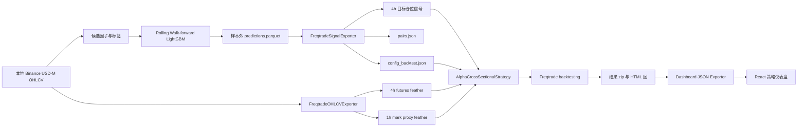

# Alpha Web3 Research 当前策略与 Freqtrade 使用手册

> 兼容基线说明：本文记录的是旧 4h/h6、每日 top-decile Freqtrade 基线，用于当前已部署 dry-run 的运维。新的研究主线已改为 1h 决策、多期限绝对 Score 和连续目标权重，见 `docs/hourly_rolling_strategy.md`。

文档版本：1.0
更新时间：2026-07-27
适用项目：`alpha-web3-research`
适用版本：Python 3.12.13、Freqtrade 2026.6、CCXT 4.5.64

## 1. 文档目的

本文说明当前横截面 LightGBM 策略如何转换为 Freqtrade 信号、如何运行历史回测、如何进行偏差检查和可视化，以及如何把新的策略结果接入统一前端。

当前系统定位是研究与回测验证，不是实盘交易系统。历史回测已经接通；Binance Futures Testnet 的真实下单、撤单和持仓同步仍属于后续阶段。

## 2. 当前实现状态

| 模块 | 状态 | 说明 |
| --- | --- | --- |
| Walk-forward 样本外预测 | 已完成 | 仅使用 `split=test` 预测生成交易信号 |
| Freqtrade 信号导出 | 已完成 | 每日横截面排序，生成持久化 4h 目标仓位 |
| 本地行情转换 | 已完成 | 项目 Parquet 转换为 Freqtrade feather |
| Freqtrade 多空策略 | 已完成 | 支持 Long、Short、方向退出和止损 |
| 历史回测 | 已完成 | 已生成交易级结果归档 |
| 前视与递归检查 | 已完成 | 未发现策略前视偏差或递归差异 |
| Freqtrade HTML 图 | 已完成 | 组合收益和单币交易图 |
| 统一策略前端 | 已完成 | 汇总所有策略和回测运行 |
| Testnet 实时模拟下单 | 未完成 | 当前 `dry_run=true` 不代表已执行 Testnet 订单 |

## 3. 系统架构



职责边界：

- 研究系统负责因子、标签、模型训练、walk-forward 和横截面选币。
- Freqtrade 不负责重新训练模型，只读取已经冻结的样本外目标仓位。
- Freqtrade 负责订单级回测语义、持仓、手续费、止损、交易报告和绘图。
- React 仪表盘只聚合 Freqtrade 结果，不参与信号生成。

## 4. 当前策略定义

### 4.1 模型来源

当前 Freqtrade 基线使用以下 walk-forward 实验：

| 项目 | 当前值 |
| --- | --- |
| 实验目录 | `walk_forward_4h_h6_forward_return_20260704T123039Z` |
| 时间周期 | 4h |
| 预测 horizon | 6 bars |
| 对应自然时间 | 24 小时 |
| 标签 | `forward_return` |
| 数据切分 | 仅 `split=test` |
| 模型 | LightGBM 横截面模型 |
| 调仓频率 | 每 24 小时 |
| 调仓时刻 | 00:00 UTC |

源预测文件：

```text
data/models/walk_forward/
  walk_forward_4h_h6_forward_return_20260704T123039Z/
  predictions.parquet
```

### 4.2 横截面选币规则

每天 00:00 UTC 执行一次横截面决策：

1. 读取该时间点所有可用币种的 `model_score`。
2. 在排序前移除显式排除的交易对。
3. 按 `model_score` 从高到低排序。
4. 分数并列时按 symbol 排序，保证结果可复现。
5. 选择数量为 `ceil(横截面币种数 × 10%)`。
6. 排名前 N 的币种目标仓位为 `1`，即做多。
7. 排名后 N 的币种目标仓位为 `-1`，即做空。
8. 其余币种目标仓位为 `0`。

当前排除 `ICP/USDT:USDT` 后共有 88 个交易对：

```text
ceil(88 × 10%) = 9
```

因此每个调仓日目标组合为：

| 方向 | 数量 |
| --- | ---: |
| Long | 9 |
| Short | 9 |
| Neutral | 70 |
| 总币种数 | 88 |

这里的“前 10%”不是用平均 percentile 阈值直接截取，而是使用 ordinal 排名精确控制数量。即使多个币种分数相同，也不会因为并列而突然选出超过 9 个币种。

### 4.3 目标仓位持续时间

模型每 24 小时产生一次决策，但 Freqtrade 策略运行在 4h K 线上。信号导出器会把每日决策向后延续 24 小时，即覆盖 6 根 4h K 线。

每行信号包含：

| 字段 | 含义 |
| --- | --- |
| `date` | 与 Freqtrade K 线对齐的 UTC 时间 |
| `pair` | Freqtrade 永续合约交易对 |
| `fold` | 来源 walk-forward fold |
| `decision_timestamp` | 该仓位来源的调仓时间 |
| `signal_valid_until` | 信号失效时间，不含该时刻 |
| `signal_valid` | 当前行是否位于有效窗口 |
| `is_rebalance` | 当前行是否为正式调仓点 |
| `target_position` | `1` Long、`-1` Short、`0` Neutral |
| `model_score` | 调仓时的模型分数 |
| `model_score_rank_pct` | 模型输出中的横截面分位值 |

精确 top/bottom 选择使用重新排序后的 `model_score`；`model_score_rank_pct` 主要用于审计和绘图。

当前信号规模：

| 指标 | 数值 |
| --- | ---: |
| 信号行数 | 36,960 |
| 调仓日 | 70 |
| 交易对 | 88 |
| Long 决策 | 630 |
| Short 决策 | 630 |
| 信号起点 | 2026-04-21 00:00 UTC |
| 信号终点 | 2026-06-29 20:00 UTC |

### 4.4 Freqtrade 入场规则

策略类：

```text
freqtrade/user_data/strategies/AlphaCrossSectionalStrategy.py
```

入场条件：

```text
signal_valid == True
volume > 0
target_position 发生变化，或位于变化后的下一根 4h K 线
```

方向映射：

| 目标仓位 | Freqtrade 信号 | Entry tag |
| --- | --- | --- |
| `1` | `enter_long=1` | `model_top_quantile` |
| `-1` | `enter_short=1` | `model_bottom_quantile` |
| `0` | 不入场 | 无 |

入场窗口保留两根 K 线，原因是 Long 和 Short 直接反转时，第一根 K 线可能同时出现旧方向退出和新方向入场。下一根 K 线的重试信号允许 Freqtrade 在旧仓位关闭后建立反向仓位。

策略只在 K 线中写入 entry flag。历史成交由 Freqtrade 的标准回测执行模型处理，不会使用当前 K 线尚未结束时才能知道的价格。

### 4.5 Freqtrade 退出规则

当前退出只由目标仓位变化和硬止损触发。

| 原方向 | 当前目标不再满足 | Exit tag |
| --- | --- | --- |
| Long | `target_position != 1` | `left_top_quantile` |
| Short | `target_position != -1` | `left_bottom_quantile` |

方向可能发生三种变化：

```text
Long -> Neutral
Short -> Neutral
Long <-> Short
```

当前没有以下退出：

- 固定 ROI 止盈。
- Trailing stop。
- 持仓超时退出。
- 基于波动率的动态止损。
- 基于模型分数绝对值的提前退出。

### 4.6 风险与资金配置

| 参数 | 当前值 | 位置 |
| --- | --- | --- |
| `can_short` | `True` | 策略 |
| `timeframe` | `4h` | 策略与配置 |
| `startup_candle_count` | `1` | 策略 |
| `minimal_roi` | `{}` | 策略 |
| `stoploss` | `-0.10` | 策略 |
| `trailing_stop` | `False` | 策略 |
| 杠杆 | 1x | `leverage()` |
| Trading mode | Futures | 配置 |
| Margin mode | Isolated | 配置 |
| 最大持仓 | 18 | 配置 |
| 初始钱包 | 10,000 USDT | 配置 |
| 可用余额比例 | 99% | 配置 |
| Stake amount | `unlimited` | 配置 |
| Liquidation buffer | 5% | 配置 |

`stake_amount=unlimited` 配合 `max_open_trades=18`，会让 Freqtrade 根据可用钱包和剩余持仓位分配资金。当前 9 Long + 9 Short 的目标数量与 18 个最大持仓槽位一致。

## 5. 数据与配置文件

### 5.1 生成文件

运行信号导出后会生成：

```text
freqtrade/user_data/signals/alpha_cross_sectional_signals.parquet
freqtrade/user_data/signals/alpha_cross_sectional_signals.json
freqtrade/user_data/pairs.json
freqtrade/config_backtest.json
```

运行行情转换后会生成：

```text
freqtrade/user_data/data/binance/futures/
  <PAIR>-4h-futures.feather
  <PAIR>-1h-mark.feather
```

当前导出规模：

| 数据 | 文件数 | 行数 |
| --- | ---: | ---: |
| 4h futures candle | 88 | 95,228 |
| 1h mark proxy | 88 | 381,088 |

### 5.2 为什么使用本地行情

研究数据已经存储在项目 Parquet 中，直接转换有三个好处：

- 保证模型训练与 Freqtrade 复核使用同一份历史 OHLCV。
- 避免重新下载造成时间范围或修订差异。
- 当前网络访问 Binance 主网 Futures 元数据端点会返回 HTTP 451。

当前折中方案：

| 数据 | 来源 |
| --- | --- |
| 历史 OHLCV | 本地 Binance 主网研究数据 |
| 合约规格 | Binance Futures Testnet |
| Mark price | 本地 1h OHLCV 代理 |
| Funding rate | 固定 0 |

Testnet 在这里仅提供合约元数据，并不代表历史价格来自 Testnet。

### 5.3 配置文件的生成原则

`freqtrade/config_backtest.json` 由信号导出器自动生成。再次运行信号导出会覆盖该文件。

需要长期修改配置时，应修改：

```text
src/alpha_web3_research/backtest/freqtrade.py
```

中的 `_freqtrade_config()`，不应只手工修改生成后的 JSON。

当前配置中的 API key 和 secret 为空。历史回测不需要私钥。

## 6. 环境安装

项目 Python 依赖使用 `uv` 管理。Freqtrade 放在独立 dependency group 中，避免普通研究命令强制安装完整交易依赖。

在项目根目录执行：

```bash
uv sync --group freqtrade --dev
```

检查版本：

```bash
uv run --group freqtrade freqtrade --version
```

预期核心版本：

```text
Python 3.12.13
CCXT 4.5.64
Freqtrade 2026.6
```

## 7. 从模型到回测的完整流程

所有命令默认在项目根目录运行：

```text
/path/to/alpha-web3-research
```

### 7.1 导出样本外信号

```bash
uv run alpha-web3-research backtest export-freqtrade-signals \
  --exclude-pairs "ICP/USDT:USDT" \
  --use-testnet-market-metadata
```

该命令默认选择：

```text
timeframe=4h
horizon_bars=6
label_column=forward_return
top_quantile_fraction=0.10
rebalance_interval_hours=24
rebalance_hour_utc=0
```

显式写全等价于：

```bash
uv run alpha-web3-research backtest export-freqtrade-signals \
  --timeframe 4h \
  --horizon-bars 6 \
  --label-column forward_return \
  --top-quantile-fraction 0.10 \
  --rebalance-interval-hours 24 \
  --rebalance-hour-utc 0 \
  --exclude-pairs "ICP/USDT:USDT" \
  --use-testnet-market-metadata
```

如果要使用指定实验：

```bash
uv run alpha-web3-research backtest export-freqtrade-signals \
  --predictions-path \
  data/models/walk_forward/<experiment_id>/predictions.parquet \
  --timeframe 4h \
  --horizon-bars 6 \
  --label-column forward_return \
  --top-quantile-fraction 0.10 \
  --exclude-pairs "ICP/USDT:USDT" \
  --use-testnet-market-metadata
```

导出器只接受匹配的 `split=test` 行。如果文件缺列、没有匹配 test 数据，或存在重复 `timestamp + symbol`，命令会直接失败。

### 7.2 转换本地 OHLCV

```bash
uv run alpha-web3-research backtest export-freqtrade-data
```

显式参数：

```bash
uv run alpha-web3-research backtest export-freqtrade-data \
  --pairs-path freqtrade/user_data/pairs.json \
  --timeframe 4h \
  --mark-timeframe 1h
```

每次 universe 或交易对清单变化后都应重新执行。

### 7.3 检查策略是否被发现

```bash
uv run --group freqtrade freqtrade list-strategies \
  --userdir freqtrade/user_data \
  -c freqtrade/config_backtest.json
```

应看到：

```text
AlphaCrossSectionalStrategy    OK
```

### 7.4 检查行情范围

```bash
uv run --group freqtrade freqtrade list-data \
  --userdir freqtrade/user_data \
  -c freqtrade/config_backtest.json \
  --trading-mode futures \
  --show-timerange
```

如果某个交易对没有 4h futures 文件，策略无法回测该交易对。

### 7.5 运行历史回测

```bash
uv run --group freqtrade freqtrade backtesting \
  --userdir freqtrade/user_data \
  -c freqtrade/config_backtest.json \
  --strategy AlphaCrossSectionalStrategy \
  --timerange 20260421-20260701 \
  --timeframe 4h \
  --fee 0.0005 \
  --cache none \
  --export trades \
  --export-directory freqtrade/user_data/backtest_results
```

关键参数解释：

| 参数 | 含义 |
| --- | --- |
| `--strategy` | 选择策略类 |
| `--timerange` | 回测时间范围 |
| `--timeframe 4h` | 与策略和信号周期一致 |
| `--fee 0.0005` | 每次成交费率 0.05%，开仓和平仓分别收取 |
| `--cache none` | 不复用旧缓存，确保新信号生效 |
| `--export trades` | 导出逐笔交易 |
| `--export-directory` | 保存 zip 和元数据 |

当前时间范围使用：

```text
2026-04-21 00:00 UTC <= timestamp < 2026-07-01 00:00 UTC
```

查看最新归档：

```bash
cat freqtrade/user_data/backtest_results/.last_result.json
```

结果归档结构：

```text
backtest-result-<timestamp>.zip
backtest-result-<timestamp>.meta.json
```

zip 内包含：

- 策略结果 JSON。
- 当次配置 JSON。
- 当次策略 Python 快照。
- 市场变化数据。
- 钱包资金曲线。

## 8. 回测结果解读

### 8.1 当前基线

| 指标 | 结果 |
| --- | ---: |
| 回测区间 | 2026-04-21 至 2026-07-01 |
| 天数 | 71 |
| 初始资金 | 10,000 USDT |
| 最终资金 | 12,635.719 USDT |
| 总收益 | +26.36% |
| 绝对收益 | +2,635.719 USDT |
| 最大回撤 | 11.47% |
| 交易数 | 996 |
| 日均交易 | 14.03 |
| 胜率 | 45.6% |
| Profit factor | 1.14 |
| 钱包日频 Sharpe | 3.20 |
| 平均持仓 | 1 天 52 分钟 |

### 8.2 Long 与 Short

| 方向 | 交易数 | 收益贡献 |
| --- | ---: | ---: |
| Long | 487 | +65.65% |
| Short | 509 | -39.29% |
| 合计 | 996 | +26.36% |

这里的 Long 和 Short 收益百分比是相对初始钱包的贡献，不是两个独立满仓账户的收益率。

当前策略的主要问题是多头有效、空头失效。不能仅根据总收益为正就判断双向模型都有效。

### 8.3 退出原因

| 退出原因 | 交易数 | 平均收益 | 绝对贡献 |
| --- | ---: | ---: | ---: |
| `left_top_quantile` | 381 | +5.83% | +12,766.049 USDT |
| `left_bottom_quantile` | 351 | +2.58% | +5,250.135 USDT |
| `stop_loss` | 264 | -10.10% | -15,380.465 USDT |

模型分位退出整体为正，但固定 10% 止损损失很大。原因之一是 universe 中包含高波动和较新的永续合约。

### 8.4 不应过度解读的指标

- 回测只有 71 天，高 CAGR 不具备长期解释力。
- 单笔平均收益 p-value 为 0.2526。
- 横截面交易在同一时间持有多个币种，交易之间并不独立。
- 当前市场同期上涨 66.94%，策略的多空结构与单纯持有市场的风险暴露不同。
- 当前 universe 是 current-active universe，存在存活者偏差。

## 9. 前视偏差与递归检查

### 9.1 Lookahead analysis

```bash
uv run --group freqtrade freqtrade lookahead-analysis \
  --userdir freqtrade/user_data \
  -c freqtrade/config_backtest.json \
  --strategy AlphaCrossSectionalStrategy \
  --timerange 20260421-20260701 \
  --timeframe 4h \
  --fee 0.0005 \
  --minimum-trade-amount 20 \
  --targeted-trade-amount 100 \
  --lookahead-analysis-exportfilename \
  reports/freqtrade/lookahead_alpha_cross_sectional.csv
```

当前结果：

```text
has_bias=False
total_signals=100
biased_entry_signals=0
biased_exit_signals=0
```

Lookahead analysis 会临时调整部分回测配置，例如使用市价单和放大钱包，目的是避免资金约束制造假阳性。配置中的 `entry_pricing.price_side=other` 用于兼容该检查。

### 9.2 Recursive analysis

```bash
uv run --group freqtrade freqtrade recursive-analysis \
  --userdir freqtrade/user_data \
  -c freqtrade/config_backtest.json \
  --strategy AlphaCrossSectionalStrategy \
  --timerange 20260421-20260701 \
  --timeframe 4h \
  --pairs BTC/USDT:USDT \
  --startup-candle 10 50 100 200
```

当前结果：

```text
No variance on indicator(s) found due to recursive formula.
No lookahead bias on indicators found.
```

策略没有 EMA 等递归技术指标，主要检查对象是外部信号合并是否随历史长度变化。

## 10. Freqtrade 原生可视化

### 10.1 组合收益图

先从 `.last_result.json` 找到结果 zip，然后传入完整路径：

```bash
uv run --group freqtrade freqtrade plot-profit \
  --userdir freqtrade/user_data \
  -c freqtrade/config_backtest.json \
  --strategy AlphaCrossSectionalStrategy \
  --backtest-filename \
  freqtrade/user_data/backtest_results/<result>.zip \
  --timerange 20260421-20260701 \
  --timeframe 4h
```

输出：

```text
freqtrade/user_data/plot/freqtrade-profit-plot.html
```

### 10.2 单币交易图

```bash
uv run --group freqtrade freqtrade plot-dataframe \
  --userdir freqtrade/user_data \
  -c freqtrade/config_backtest.json \
  --strategy AlphaCrossSectionalStrategy \
  --backtest-filename \
  freqtrade/user_data/backtest_results/<result>.zip \
  --pairs H/USDT:USDT EPIC/USDT:USDT \
  --timerange 20260421-20260701 \
  --timeframe 4h \
  --indicators2 target_position model_score_rank_pct
```

输出示例：

```text
freqtrade/user_data/plot/freqtrade-plot-H_USDT_USDT-4h.html
freqtrade/user_data/plot/freqtrade-plot-EPIC_USDT_USDT-4h.html
```

图中的两个附加指标：

| 指标 | 作用 |
| --- | --- |
| `target_position` | 检查 Long、Short、Neutral 目标切换 |
| `model_score_rank_pct` | 检查模型分位与交易时点 |

如果出现 `No trades found`，通常是 `--backtest-filename` 没有传完整路径。

## 11. 统一策略前端

### 11.1 导出前端数据

```bash
uv run alpha-web3-research backtest export-dashboard-data
```

该命令会扫描：

```text
freqtrade/user_data/backtest_results/*.zip
```

并生成：

```text
dashboard/public/data/backtests.json
```

聚合内容包括：

- 每个策略的所有运行。
- 收益、回撤、Sharpe、Profit factor 和胜率。
- 每日资金曲线和回撤。
- Long 与 Short 贡献。
- 币种收益贡献。
- Entry tag 与 Exit reason。
- 月度和星期表现。
- 全部逐笔交易。

### 11.2 启动前端

首次运行：

```bash
cd dashboard
npm install
npm run dev
```

访问：

```text
http://127.0.0.1:4173
```

页面包括：

| 页面 | 功能 |
| --- | --- |
| 策略总览 | 核心指标、资金曲线、多空贡献、退出结构、币种贡献、周期表现 |
| 策略对比 | 收益回撤散点、多运行归一化资金曲线、运行表 |
| 交易明细 | 按币种、方向、盈亏和退出原因过滤，支持 CSV 导出 |

新回测完成后：

```bash
cd ..
uv run alpha-web3-research backtest export-dashboard-data
```

然后点击页面右上角刷新按钮。

### 11.3 前端生产构建与测试

```bash
cd dashboard
npm run typecheck
npm run build
npm run test:e2e
```

当前验证：

```text
Python pytest: 9 passed
Playwright: 4 passed
Desktop viewport: 1440 × 1000
Mobile viewport: 390 × 844
```

## 12. 增加新策略

### 12.1 新增策略类

把新策略放入：

```text
freqtrade/user_data/strategies/
```

每个策略使用不同类名，例如：

```text
AlphaCrossSectionalLongOnlyStrategy
AlphaCrossSectionalVolScaledStrategy
AlphaCrossSectionalDynamicStopStrategy
```

不要只复制文件而保留相同 Python 类名，否则 Freqtrade 无法清晰区分策略。

### 12.2 验证策略发现

```bash
uv run --group freqtrade freqtrade list-strategies \
  --userdir freqtrade/user_data \
  -c freqtrade/config_backtest.json
```

### 12.3 运行多个策略

相同 timeframe 和数据配置的策略可以使用：

```bash
uv run --group freqtrade freqtrade backtesting \
  --userdir freqtrade/user_data \
  -c freqtrade/config_backtest.json \
  --strategy-list \
  AlphaCrossSectionalStrategy \
  AlphaCrossSectionalLongOnlyStrategy \
  --timerange 20260421-20260701 \
  --timeframe 4h \
  --fee 0.0005 \
  --cache none \
  --export trades \
  --export-directory freqtrade/user_data/backtest_results
```

不同 timeframe 的策略建议分别运行，避免共享命令参数造成歧义。

回测结束后重新执行：

```bash
uv run alpha-web3-research backtest export-dashboard-data
```

Dashboard exporter 会遍历 zip 中的所有 strategy key，新策略会自动出现在前端。

## 13. 常见问题

### 13.1 找不到信号文件

错误：

```text
Freqtrade signal file not found
```

处理：

```bash
uv run alpha-web3-research backtest export-freqtrade-signals \
  --exclude-pairs "ICP/USDT:USDT" \
  --use-testnet-market-metadata
```

也可以通过环境变量临时指定信号：

```bash
export ALPHA_FREQTRADE_SIGNAL_PATH=/absolute/path/to/signals.parquet
```

### 13.2 找不到本地 OHLCV

错误：

```text
local OHLCV not found for <pair> <timeframe>
```

检查项目数据：

```text
data/ohlcv/exchange=binanceusdm/market_type=swap/
```

缺失时需要先补采对应交易对和 timeframe，再运行 `export-freqtrade-data`。

### 13.3 Binance 主网 HTTP 451

当前网络环境访问 Binance Futures 主网元数据可能返回 451。历史回测使用：

```bash
--use-testnet-market-metadata
```

该参数只改变合约元数据来源，不把历史 OHLCV 切换成 Testnet。

### 13.4 ICP 不在 Testnet 元数据

当前显式排除：

```bash
--exclude-pairs "ICP/USDT:USDT"
```

排除发生在横截面排序前，因此剩余币种会重新排名。

### 13.5 Funding rate 警告

Freqtrade 可能提示：

```text
No history for <pair>, funding_rate, 1h found
```

当前配置使用：

```json
"futures_funding_rate": 0.0
```

这只是基线假设。正式策略评估必须加入真实 funding rate。

### 13.6 Lookahead analysis 的 market order 配置错误

错误：

```text
Market entry orders require entry_pricing.price_side = "other"
```

当前生成器已把 entry 和 exit 的 `price_side` 设置为 `other`。如果旧配置仍报错，重新运行信号导出生成配置。

### 13.7 Plot 找不到交易

错误：

```text
No trades found
```

`--backtest-filename` 应使用完整相对路径或绝对路径，而不是只写 zip 文件名。

### 13.8 前端数据没有更新

前端不会直接读取 zip。先执行：

```bash
uv run alpha-web3-research backtest export-dashboard-data
```

再刷新浏览器。

### 13.9 前端显示无法载入策略结果

确认文件存在：

```text
dashboard/public/data/backtests.json
```

并确认前端通过 Vite 启动，而不是直接双击 `index.html`。

## 14. 当前限制

当前回测结果尚未覆盖：

- 真实 funding rate。
- 真实 mark price。
- Bid-ask spread。
- Slippage。
- 市场冲击和容量。
- 订单部分成交。
- 动态最小下单量变化。
- 历史时点 universe，当前存在存活者偏差。
- Testnet 的真实订单状态机。
- 实盘 API 重连、撤单和仓位恢复。

当前 `dry_run=true` 的含义是配置不会使用真实资金。执行 `freqtrade backtesting` 时仍然只是历史回测，不会向 Binance Futures Testnet 发送订单。

## 15. 下一轮策略优化

建议优先级：

1. 做 Long-only 基线，与当前 Long/Short 策略并行比较。
2. 为 Short 单独训练模型、标签或阈值，停止对称复制 Long 逻辑。
3. 使用波动率缩放仓位，降低高波动新币的单币风险。
4. 对止损运行网格：无硬止损、15%、20% 和波动率止损。
5. 加入新上市合约冷却期。
6. 加入真实 funding rate 和 mark price。
7. 加入滑点、点差和成交量容量约束。
8. 延长独立样本外时间。
9. 完成 Binance Futures Testnet dry-run 订单链路。

## 16. 回测操作检查表

### 回测前

- [ ] 已完成目标 walk-forward 实验。
- [ ] 只使用 `split=test` 预测。
- [ ] timeframe、horizon 和 label 与实验一致。
- [ ] 排除交易对在排序前处理。
- [ ] 已重新导出 signals、pairs 和 config。
- [ ] 已重新导出 Freqtrade OHLCV。
- [ ] `list-strategies` 显示策略状态为 `OK`。
- [ ] `list-data` 覆盖目标时间范围。

### 回测后

- [ ] 保存结果 zip 和 meta JSON。
- [ ] 记录 fee、stoploss、leverage 和最大持仓。
- [ ] 分开检查 Long 与 Short。
- [ ] 检查 stop loss 贡献。
- [ ] 运行 lookahead analysis。
- [ ] 运行 recursive analysis。
- [ ] 生成 Freqtrade HTML 图。
- [ ] 重新导出 dashboard 数据。
- [ ] 不把 71 天 CAGR 当作长期收益预测。

## 17. 关键文件索引

| 路径 | 用途 |
| --- | --- |
| `src/alpha_web3_research/backtest/freqtrade.py` | 信号、配置和 OHLCV 导出 |
| `src/alpha_web3_research/backtest/dashboard.py` | 多策略结果聚合 |
| `src/alpha_web3_research/cli.py` | 项目 CLI |
| `freqtrade/user_data/strategies/AlphaCrossSectionalStrategy.py` | 当前 Freqtrade 策略 |
| `freqtrade/config_backtest.json` | 生成的回测配置 |
| `freqtrade/user_data/signals/` | 外部模型信号 |
| `freqtrade/user_data/data/binance/futures/` | Freqtrade 行情 |
| `freqtrade/user_data/backtest_results/` | 回测归档 |
| `freqtrade/user_data/plot/` | Freqtrade HTML 图 |
| `dashboard/src/App.tsx` | 策略仪表盘前端 |
| `dashboard/public/data/backtests.json` | 前端标准化数据 |
| `reports/freqtrade/baseline_4h_h6_forward_return_20260727.md` | 首轮回测报告 |
| `reports/freqtrade/lookahead_alpha_cross_sectional.csv` | 前视检查结果 |
